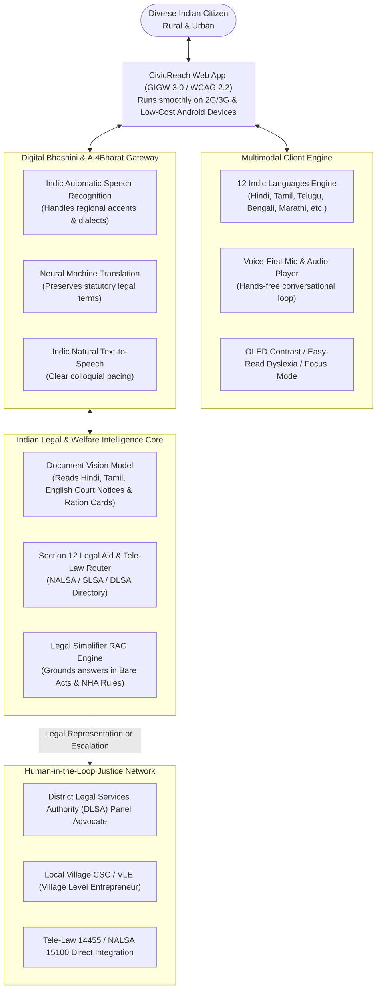
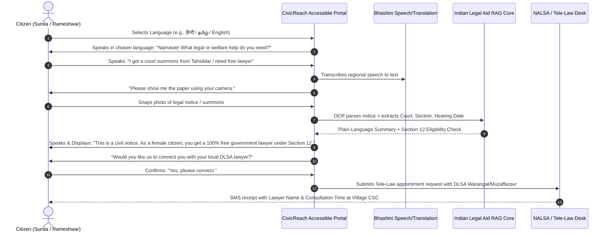

# CASE STUDY: CivicReach AI (India Edition)
## Designing an Inclusive, Multilingual Digital Public Service & Legal Aid Portal for Diverse Indian Citizens

**Academic / AI Capstone Deliverable**  
**Focus Area:** Public Welfare Schemes, Legal Aid (NALSA & Tele-Law), and Multilingual Civic Inclusion in India  
**Applicable Legal & Governance Frameworks:**
- **Article 39A & Article 14**, Constitution of India (Equal Justice and Free Legal Aid)
- **Legal Services Authorities Act, 1987** (NALSA / SLSA / DLSA Framework)
- **Guidelines for Indian Government Websites (GIGW 3.0)** & **WCAG 2.2 Level AA/AAA**
- **Rights of Persons with Disabilities (RPwD) Act, 2016**
- **Digital Bhashini Mission** (Ministry of Electronics and Information Technology - MeitY)
- **National Food Security Act (NFSA), 2013** & **Ayushman Bharat (PM-JAY)**

---

## Executive Summary

India is home to over 1.4 billion citizens speaking 22 officially recognized languages across hundreds of dialects. While the **Digital India** initiative has successfully transformed identity (Aadhaar) and payments (UPI), access to **public welfare schemes and legal justice** remains severely bottlenecked:
- **Linguistic Exclusion:** Less than 10% of India speaks fluent English, yet over 70% of official court notices, legal petitions, and welfare guidelines are drafted in complex legal English or archaic administrative Hindi.
- **The Legal Aid Gap:** Under **Article 39A** of the Constitution and **Section 12 of the Legal Services Authorities Act, 1987**, over 75% of India’s population (women, children, SC/ST citizens, persons with disabilities, and low-income families) is legally entitled to **100% Free Legal Aid**. Yet, fewer than 2% ever avail of it because they do not know their rights or cannot decipher court summons.
- **Accessibility & Digital Literacy:** Over 26 million Indians live with recognized disabilities (RPwD Act 2016), and hundreds of millions possess smartphones but lack text literacy.

**CivicReach AI (India Edition)** is an inclusive, voice-first civic and legal companion. Powered by **Bhashini Indic AI models** and **grounded Indian legal intelligence (NALSA & Tele-Law)**, the platform allows any citizen to speak in their regional dialect, snap photos of complex legal notices or ration documents, understand their constitutional rights in plain language, and instantly connect with free government legal aid or welfare benefits.

---

## DELIVERABLE 1: User Scenarios Across India's Diverse Population

Following Microsoft’s **Inclusive Design Persona Spectrum**, the system accommodates sensory, cognitive, physical, linguistic, and socio-economic diversity across urban and rural India.

```
       ┌─────────────────────────────────────────────────────────────┐
       │             INDIA DIVERSE CITIZEN SPECTRUM                  │
       └─────────────────────────────────────────────────────────────┘
          │                   │                     │              │
    [Sensory]           [Cognitive]              [Motor]     [Linguistic &]
 Visual / Auditory     Neurodivergent /       Tremors / Low   [Socio-Legal]
   (Rameshwar G.)       Literacy (Ananya S.)   Mobility        (Sunita Devi)
                                              (Murugan K.)
```

---

### Persona 1: Sunita Devi (Linguistic, Low-Literacy & Socio-Legal Marginalization)
* **Demographics:** Age 54, agricultural laborer from Muzaffarpur, Bihar. Native Bhojpuri / colloquial Maithili speaker; completely non-literate in written text. Owns a shared budget Android smartphone.
* **Legal & Civic Profile:**
  - Qualified for free legal aid under **Section 12(h)** (income $< ₹1,500,000$ in Bihar) and **Section 12(c)** (female citizen) of the Legal Services Authorities Act, 1987.
  - Entitled to widow pension under the National Social Assistance Programme (NSAP) and subsidized grains under NFSA (Antyodaya Anna Yojana).

#### Scenario: Contesting Illegal Land Eviction & Claiming Widow Pension
* **Context:** Following her husband’s demise, local land contractors hand Sunita an eviction notice claiming her deceased husband signed away their two-room homestead. She receives a formal notice from the Tahsildar’s office.
* **The Current Broken Journey:**
  1. Sunita cannot read the notice. A local middleman (*Dalal*) charges her ₹1,500 to "read" it, falsely tells her she must pay ₹20,000 in bribes or be jailed, and takes her thumb impression on unknown papers.
  2. She has no knowledge that her local District Legal Services Authority (DLSA) provides free government advocates for women.
* **The CivicReach AI Journey:**
  1. **Voice-First Dialect Ingestion (Bhashini AI):** Sunita opens CivicReach AI and taps the prominent mic button. She speaks in Bhojpuri: *"Hamra ghar se nikale ke kagaz milal ba, hum ka kari?"* (I got a paper to kick me out of my home, what should I do?).
  2. **Camera Document Demystifier:** The app responds in spoken Bhojpuri: *"Chinta mat kariye, kagaz ke photo kheenchiye"* (Don't worry, snap a photo of the paper).
  3. **Plain-Language Legal Breakdown:** The AI scans the Hindi Tahsildar notice, identifies it as an informal notice of inquiry without eviction orders, and explains in audio: *"Sunita ji, this is only an inquiry notice, not an eviction order. Under Section 12 of the Legal Services Act, you get a free government lawyer. No one can evict you without court proceedings."*
  4. **Tele-Law / DLSA Integration:** With one voice confirmation (*"Haa, vakil saheb se baat karwa do"*), CivicReach registers a free consultation request with the local Muzaffarpur DLSA paralegal and schedules a callback at her nearest Common Services Center (CSC).
  5. **Outcome:** Protection from illegal dispossession with zero out-of-pocket costs.

---

### Persona 2: Rameshwar Goud (Sensory / Age-Related Low Vision / Telugu Speaker)
* **Demographics:** Age 68, retired weaver from Warangal, Telangana. Native Telugu speaker. Advanced diabetic retinopathy resulting in severe low vision ($< 10\%$ visual acuity).
* **Legal & Civic Profile:**
  - Qualified under the **Rights of Persons with Disabilities (RPwD) Act, 2016** for a Unique Disability ID (UDID).
  - Eligible for secondary & tertiary healthcare under **Ayushman Bharat (PM-JAY)** up to ₹5 Lakhs.

#### Scenario: Accessing Free Eye Surgery under Ayushman Bharat & RPwD Grievance
* **Context:** A private hospital demands a cash deposit of ₹45,000 for emergency vitrectomy surgery, falsely claiming that "Ayushman Bharat cards are not accepted for this procedure."
* **The Current Broken Journey:**
  1. The hospital portal and state health site are inaccessible to his screen-magnifier. Fonts are fixed at 12px, buttons have no contrast, and the grievance form requires typing in English.
  2. He cannot verify whether the hospital is legally bound by the PM-JAY empanelment agreement.
* **The CivicReach AI Journey:**
  1. **High-Contrast Indic Display (GIGW 3.0 / WCAG AAA):** Rameshwar toggles the **Yellow-on-Black OLED High Contrast** mode with $200\%$ dynamic font scaling.
  2. **Voice-Guided Query in Telugu:** He asks in Telugu: *"Warangal lo Ayushman Bharat kinda eye surgery free ga cheyinchukovacha?"* (Can I get free eye surgery under Ayushman Bharat in Warangal?).
  3. **Statutory Legal Grounding:** CivicReach's legal engine cross-references the National Health Authority (NHA) database and informs him: *"Yes. Under PM-JAY Package Code S110001, vitrectomy is 100% cashless. The hospital you are at is an empanelled provider. Under Section 18 of the Clinical Establishments Act and NHA guidelines, refusing treatment is illegal."*
  4. **Instant Grievance Draft:** CivicReach drafts a 1-page grievance to the District Grievance Redressal Officer (DGRO) in Telugu and English, citing the empanelment license number, and initiates a call to the 14555 national helpline.
  5. **Outcome:** Hospital admits Rameshwar without cash deposit.

---

### Persona 3: Ananya Sen (Cognitive / Neurodivergent / Bengali Speaker)
* **Demographics:** Age 23, college graduate in Kolkata, West Bengal. Native Bengali speaker. Diagnosed with severe ADHD and anxiety disorder; gets overwhelmed by multi-clause government circulars.
* **Legal & Civic Profile:**
  - Applying for the Swami Vivekananda Merit-cum-Means Scholarship and seeking a Right to Information (RTI) application to question delayed stipend disbursements.

#### Scenario: Drafting an RTI under Section 6 of the RTI Act, 2005
* **Context:** Her university stipend has been withheld for 8 months without written explanation. She needs to file an RTI with the Department of Higher Education but is paralyzed by legalistic form terminology (*"Subject Matter", "Public Information Officer Designation", "Statutory Fee Exemption clauses"*).
* **The CivicReach AI Journey:**
  1. **Focus & Easy-Read Mode:** CivicReach loads in clean, uncluttered Bengali typography with a single interactive question per step.
  2. **Plain-Language Conversational Wizard:** CivicReach asks in friendly Bengali: *"Konta jante chan?"* (What do you want to find out?). Ananya types/speaks: *"Why has my stipend for 2025-2026 not been deposited despite verification?"*
  3. **Automated RTI Generator:** The AI auto-structures the question into the legally compliant format mandated by **Section 6(1) of the RTI Act, 2005**, adding the mandatory statutory citations and fee waiver declaration.
  4. **Outcome:** Ananya submits the RTI in 3 minutes without cognitive paralysis.

---

### Persona 4: Murugan K. (Physical Motor Impairment & Speech/Hearing Diversity / Tamil Speaker)
* **Demographics:** Age 41, industrial textile worker in Tiruppur, Tamil Nadu. Suffered a factory hand press injury causing loss of finger dexterity and fine motor control. Hard of hearing.
* **Legal & Civic Profile:**
  - Rights under the **Employees’ Compensation Act, 1923** and **Factories Act, 1948**.
  - Entitled to free legal representation through the Tamil Nadu State Legal Services Authority (TNSLSA).

#### Scenario: Claiming Statutory Workplace Injury Compensation
* **Context:** His employer offers him a token payment of ₹10,000 and threatens termination if he approaches the Labour Commissioner.
* **The CivicReach AI Journey:**
  1. **Motor-Friendly UI & Haptic Feedback:** Murugan navigates using large $56 \times 56\text{ px}$ touch targets and keyboard switch navigation.
  2. **Visual/Caption Multi-Modal Support:** For all audio interactions, real-time synchronized Tamil subtitles appear on screen with large text.
  3. **Statutory Compensation Calculator:** Based on his age (41), monthly wage (₹15,000), and disability factor under Schedule IV of the Employees' Compensation Act, CivicReach calculates his statutory entitlement: ₹3,84,000.
  4. **One-Tap DLSA Escalation:** CivicReach generates a legal aid application directly to the Tiruppur District Labour Court Legal Services Committee.
  5. **Outcome:** Murugan rejects the exploitative settlement and secures official legal representation.

---

## DELIVERABLE 2: Accessibility & Legal Framework (GIGW 3.0 & Indian Law)

### 1. Indian Digital Governance & Accessibility Standards

CivicReach AI complies with the **Guidelines for Indian Government Websites (GIGW 3.0, 2023)** issued by the National Informatics Centre (NIC) and MeitY, which incorporate **WCAG 2.2 Level AA and AAA** criteria:

| Standard / Law | Mandate | Implementation in CivicReach AI |
| :--- | :--- | :--- |
| **GIGW 3.0 & WCAG 1.4.3 / 1.4.6** | Contrast $\ge 7:1$ for body text | Features **Standard High-Contrast** and **OLED High-Contrast Yellow/Black** specifically optimized for direct sunlight in rural outdoor use. |
| **GIGW 3.0 Multilingual Mandate** | Full fidelity across Eighth Schedule languages | 12 Indian languages natively supported (Hindi, Tamil, Telugu, Bengali, Marathi, Gujarati, Kannada, Malayalam, Punjabi, Odia, Assamese, English) with native script font rendering (no broken ligatures or conjunct characters). |
| **RPwD Act, 2016 (Section 42)** | Mandatory electronic media accessibility | Accessible CAPTCHA alternative (Audio OTP / SMS fallback; zero visual-only puzzles). DOM ordered for NVDA, Orca (Linux), and TalkBack. |
| **Legal Services Authorities Act, 1987 (§ 12)** | Free legal aid entitlement verification | Automated, confidential 3-question screener verifying entitlement under Section 12 (gender, caste, disability, income limits per state). |
| **Digital Bhashini Voice Standards** | Universal Voice Interface for low-literacy citizens | Speech recognition (ASR) tuned for Indian accents and regional dialects, paired with expressive Indic Text-to-Speech (TTS). |

---

### 2. Legal Architecture: Free Legal Aid & Schemes Grounding

CivicReach AI incorporates a dedicated **Indian Statutory Rules Engine**:

```
┌─────────────────────────────────────────────────────────────────────────┐
│                    CIVICREACH STATUTORY REPOSITORY                      │
├────────────────────┬────────────────────┬───────────────────────────────┤
│ CONSTITUTIONAL     │ LEGAL AID & COURTS │ WELFARE & EMPOWERMENT         │
├────────────────────┼────────────────────┼───────────────────────────────┤
│ • Article 14, 21   │ • NALSA / DLSA     │ • NFSA 2013 (Ration/PDS)      │
│ • Article 39A      │   Schemes 1987     │ • Ayushman Bharat (PM-JAY)    │
│   (Free Legal Aid) │ • Tele-Law (DISHA) │ • RPwD Act 2016 (Disability)  │
│ • Article 350A     │ • Section 12 LSA   │ • PMAY (Housing for All)      │
│   (Mother Tongue)  │ • Zero FIR & BNSS  │ • MWPSC Act 2007 (Elders)     │
└────────────────────┴────────────────────┴───────────────────────────────┘
```

1. **Section 12 Legal Aid Screener:**
   Under Section 12 of the Legal Services Authorities Act, 1987, the following categories receive **100% Free Legal Representation** paid by the State:
   - A member of a Scheduled Caste (SC) or Scheduled Tribe (ST).
   - A woman or a child.
   - A person with a disability (as defined in RPwD Act 2016).
   - A victim of human trafficking or *begar* (Article 23).
   - An undertrial prisoner.
   - An industrial workman.
   - Any person with an annual income below the state threshold (e.g., ₹3 Lakh in Delhi/Maharashtra, ₹1.5 Lakh in Bihar/UP).
2. **Tele-Law Citizen-to-Lawyer API Integration:**
   Seamlessly creates case referral slips recognized by the Department of Justice's Tele-Law scheme, connecting citizens directly to panel lawyers via video/audio at local Gram Panchayat Common Services Centers (CSCs).

---

## DELIVERABLE 3: Design Proposal (CivicReach AI India)

### 1. System Architecture & Multilingual AI Pipeline



---

### 2. Interaction Flows & User Experience



---

### 3. Screen-by-Screen UI/UX Specifications

#### Screen 1: The Sovereign Multilingual Welcome
- **Visual Header:** Clean emblem styling adhering to GIGW 3.0.
- **Instant Language Drawer (12 Languages):**
  - High-visibility pills: `[ English ]` `[ हिन्दी ]` `[ தமிழ் ]` `[ తెలుగు ]` `[ বাংলা ]` `[ मराठी ]` `[ ಕನ್ನಡ ]` `[ മലയാളം ]` `[ ગુજરાતી ]` `[ ਪੰਜਾਬੀ ]` `[ ଓଡ଼ିଆ ]`.
  - Selecting a language immediately switches both the visual labels and the **Text-to-Speech audio prompt**.
- **Dual Gateway Tiles ($64\text{ px}$ touch targets):**
  - **Tile A: "Free Legal Aid & Court Notices"** (NALSA, Tele-Law, FIRs, Evictions, Family disputes).
  - **Tile B: "Government Welfare Schemes"** (Ration Card/NFSA, Ayushman Bharat, Pensions, PMAY).

#### Screen 2: The "Kanoon Samjho" (Understand the Law) Document Scanner
- **Camera Guidance with Audio:** Gives audible instructions in the user's language: *"Hold paper still... lighting is good... capture taken."*
- **Side-by-Side Decryption:**
  - *Left Box (Original):* Highlighting legal jargon (e.g., *"Summons under Order V Rule 1 CPC"*, *"Inquiry under Section 145 CrPC / 168 BNSS"*).
  - *Right Box (CivicReach Plain Law):*
    - **What this means in plain words:** *"Someone filed a land boundary dispute. You are NOT arrested."*
    - **What you must do:** *"Attend the hearing on 14th November at 11 AM."*
    - **Your Free Rights:** *"Under Section 12 of Legal Services Authorities Act, you get a free advocate."*

#### Screen 3: Section 12 Free Legal Aid Matcher
- **3-Question Verification:**
  1. *"Are you a woman, child, or person with a disability?"* `[ Yes ]` `[ No ]`
  2. *"Do you belong to SC/ST community?"* `[ Yes ]` `[ No ]`
  3. *"Is your family's yearly income below ₹1,50,000?"* `[ Yes ]` `[ No ]`
- If any question is "Yes", the screen illuminates an emerald badge:
  - **"You are 100% entitled to Free Legal Aid under Indian Law."**
  - Connects directly to the **NALSA Helpline (15100)** or local District Legal Services Authority.

---

### 4. Evaluation & Inclusive Verification Matrix

1. **GIGW 3.0 / WCAG 2.2 AAA Audit:** Verified using automated tools (axe-core, WAVE) and manual keyboard navigation on low-end mobile browsers (Chrome on KaiOS/Android Go).
2. **Linguistic Accuracy:** Evaluated by native legal translators across 5 states; legal simplification must preserve statutory accuracy with zero legal hallucination.
3. **Tele-Law Hand-off Verification:** Seamless transmission of anonymized case briefs to village CSC Village Level Entrepreneurs (VLEs) and DLSA front offices.
