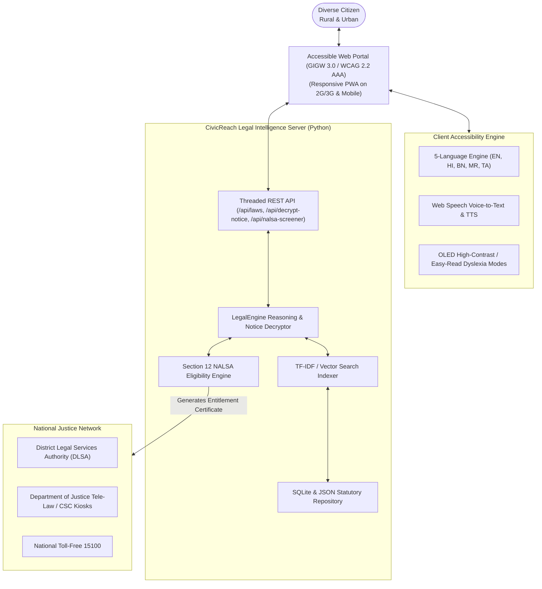

# 🏛️ CivicReach AI (India Edition)
### Inclusive Digital Public Service & Multilingual Indian Legal Aid Software

[](LICENSE)
[](https://python.org)
[](#accessibility)
[](#official-indian-legal-database)

**CivicReach AI** is an inclusive, voice-first digital public service and legal aid platform designed for diverse Indian citizens. It bridges the critical gap between complex statutory laws and the common citizen by translating legal jargon, court notices, and welfare rules into **4th-grade plain language** across major Indian languages, while automatically determining entitlement to **100% Free Legal Representation under Article 39A and Section 12 of the Legal Services Authorities Act, 1987 (NALSA)**.

---

## 🌟 Key Highlights

- **🇮🇳 Multi-Language Support:**
  - **English (Default)**
  - **हिन्दी (Hindi)** — ~43.6% of India (52.8 Crore speakers)
  - **বাংলা (Bengali)** — ~8.0% of India (9.7 Crore speakers)
  - **मराठी (Marathi)** — ~6.9% of India (8.3 Crore speakers)
  - **தமிழ் (Tamil)** — ~5.7% of India (6.9 Crore speakers)
  - All screens, statutory summaries, document decryptions, and voice narrations are dynamically localized.

- **⚖️ Official Indian Legal Knowledge Base & Penal Codes:**
  - **Bharatiya Nyaya Sanhita, 2023 (BNS)** with complete cross-mappings to the **Indian Penal Code (IPC), 1860** (Theft, Cheating/420, Hurt, Cruelty/Dowry, Cyber scams, Murder).
  - **Bharatiya Nagarik Suraksha Sanhita, 2023 (BNSS)** with cross-mappings to the **Code of Criminal Procedure (CrPC), 1973** (Zero FIR, Arrest rights, Section 341 free court defense, Bail, Section 168/145 land dispute summons).
  - **Constitution of India, 1950** (Article 14, Article 21, Article 39A Free Legal Aid, Article 22, Writs under Art 32/226).
  - **Legal Services Authorities Act, 1987** (Section 12 eligibility for women, children, SC/ST, PwD, undertrials, and low-income families).
  - **Rights of Persons with Disabilities (RPwD) Act, 2016** (Accessibility mandates, non-discrimination).
  - **Protection of Women from Domestic Violence Act (PWDVA), 2005** (Protection and residence orders).
  - **Consumer Protection Act, 2019** & **Right to Information (RTI) Act, 2005**.
  - **National Food Security Act (NFSA), 2013** & **Ayushman Bharat (PM-JAY)**.

- **📜 "Kanoon Samjho" Notice Decryptor:**
  - Ingests real-world court summons (SDM land inquiry notices under BNSS 168 / CrPC 145), hospital PM-JAY billing denials, or police notices, removing fear by stating: *"DO NOT PANIC: This is not an arrest warrant."* and providing actionable next steps.

- **🎙️ Multimodal & High Accessibility:**
  - Complies with **Guidelines for Indian Government Websites (GIGW 3.0)** and **WCAG 2.2 Level AAA**.
  - **OLED High-Contrast Mode** (Yellow on Black `#000000` & `#FFE600`, contrast $> 7:1$).
  - **Easy-Read / Dyslexia Mode** with expanded line spacing and simplified phrasing.
  - **Voice-First Navigation** using the Web Speech API (speech recognition and natural Indic TTS).
  - **ARIA Live Telemetry Logger** for assistive screen reader users (NVDA, JAWS, TalkBack).

- **⚡ Zero Setup Friction:**
  - Runs out of the box using Python's standard library with zero external pip dependencies required.

---

## 🚀 Quick Start Guide

### 1. Run the Web Application
Clone the repository and launch the application with a single command:

```bash
git clone https://github.com/OjasNeelabh/civicreach-ai.git
cd civicreach-ai
python run.py
```
This automatically starts the multi-threaded server on `http://localhost:8000` and opens your browser.

---

### 2. Command-Line Interface (CLI)

CivicReach AI also includes a command-line interface for terminal users:

```bash
# Search any Indian law or penal section in Hindi:
python -m civicreach search "cheating 420" --lang hi

# Search land dispute summons in Tamil:
python -m civicreach search "land dispute" --lang ta

# Decrypt an SDM court summons notice:
python -m civicreach decrypt "न्यायालय अनुमंडल दंडाधिकारी धारा 145 CrPC मौजा रामपुर भूमि विवाद" --lang hi

# Check NALSA Section 12 free legal aid eligibility:
python -m civicreach aid --woman --income 120000 --lang en

# Start server on custom port:
python -m civicreach serve --port 8080
```

---

## 🏗️ System Architecture



---

## 📂 Repository Structure

```
civicreach-ai/
├── README.md                           # Documentation, setup, usage, GitHub instructions
├── LICENSE                             # MIT Open Source License
├── requirements.txt                    # Optional acceleration dependencies
├── pyproject.toml                      # Modern packaging configuration
├── run.py                              # Zero-dependency entrypoint launcher
├── CASE_STUDY.md                       # Comprehensive design case study & user scenarios
├── data/
│   ├── indian_laws.json                # Curated statutory database (BNS, BNSS, IPC, CrPC, NALSA, etc.)
│   └── civicreach.sqlite               # Local high-speed SQLite database
├── civicreach/
│   ├── __init__.py                     # Package initialization
│   ├── __main__.py                     # CLI module runner
│   ├── database.py                     # SQLite / JSON legal repository loader
│   ├── indexer.py                      # TF-IDF & semantic search engine
│   ├── legal_engine.py                 # Core legal reasoning & notice decryption
│   ├── nalsa_screener.py               # Section 12 NALSA legal aid evaluator
│   ├── i18n.py                         # 5-language localization engine (EN, HI, BN, MR, TA)
│   ├── server.py                       # Built-in multi-threaded HTTP & REST server
│   └── cli.py                          # Terminal CLI implementation
├── web/
│   ├── index.html                      # Accessible responsive web interface
│   ├── css/
│   │   └── styles.css                  # GIGW 3.0 / WCAG AAA custom accessibility styles
│   └── js/
│       └── app.js                      # Reactive frontend application logic
└── tests/
    └── test_legal_engine.py            # Automated unit test suite
```

---

## 🧪 Automated Testing

Run the test suite to verify search indexing, multilingual translations, notice decryption, and Section 12 eligibility:

```bash
python -m unittest discover tests
```

---

## 📤 Pushing to Your GitHub Repository

To push this project to your GitHub account:

```bash
# 1. Initialize git (if not already initialized)
git init
git branch -M main

# 2. Add remote origin pointing to your repository
git remote add origin https://github.com/OjasNeelabh/civicreach-ai.git

# 3. Commit and push
git add .
git commit -m "feat: complete CivicReach AI inclusive public service & legal aid software"
git push -u origin main
```

---

## ⚖️ Legal Disclaimer

*CivicReach AI is an assistive digital public service tool designed to simplify legal information, provide initial guidance, and connect citizens with government legal aid under the Legal Services Authorities Act, 1987. It does not replace formal legal counsel from an authorized advocate.*

---

**Developed with ❤️ by [Ojas Neelabh](https://github.com/OjasNeelabh)**
